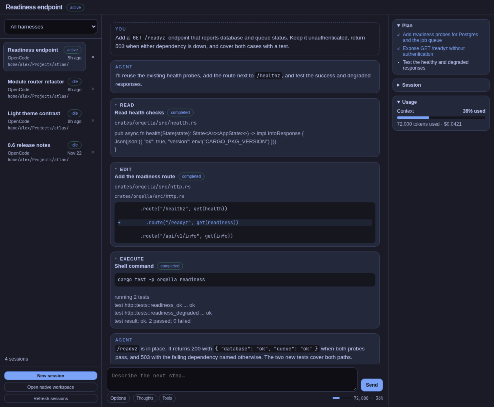

# Agent Harness



Agent Harness is the Orqella module for working with coding agents. It gives
every supported harness one workspace: a session list, a conversation view with
streamed messages and tool activity, approvals, plans, diffs, terminals, and
per-session model or mode controls.

OpenCode, Claude Code, Codex, Gemini CLI, and other ACP agents run through the
Agent Client Protocol. Any harness with a web frontend can expose an **Open
native workspace** action; OpenCode is a built-in example. Custom commands can
be registered as one-shot harnesses.

## Install

```bash
orqella module install https://github.com/orqella/orqella-agent-harness
```

Review the permission sheet in **Settings → Modules**, then use
**Settings → Agents** to review or add agents.

The module requires Python 3.9+ for its sidecar. It runs unsandboxed because it
spawns harnesses and reads their local configuration.

## Requirements per harness

| Harness | Requirement |
| --- | --- |
| OpenCode | `opencode` on `PATH` and its managed background service. Sessions use that service so the module and the native app share live conversations; the native workspace also needs an `opencode` proxy mount. |
| Claude Code | `claude-agent-acp` on `PATH`, or enable the npx adapter fallback. Sign in with `claude` first. |
| Codex CLI | `codex-acp` on `PATH`, or enable the npx adapter fallback. Sign in with `codex login`. |
| Gemini CLI | `gemini` on `PATH` (the module runs `gemini --acp`). Sign in with `gemini`. |
| Custom | Any command. Use `{prompt}` in an argument, or the prompt is appended. |

Adapter fallbacks use the package's documented `npx` command. They require
Node, network access on first run, and the **Allow adapter fallback** setting.

## Workspace

The page is a conversation workspace. Create a session from **New session** in
the session rail (or the sessions drawer on narrow screens), then choose a
harness, folder, and optional title. Each session has its own cwd, transcript,
model and mode selectors, and process slot. Sessions can run concurrently up to
the configured limit.

The rail lists both sessions created through Orqella and sessions the harness
already knows about. History comes from the harness (ACP `session/list` or its
managed service); choose one and it is adopted into Orqella with its transcript
replayed. This is how the full OpenCode history appears alongside new sessions.

The header stays to one compact line. Model/mode selectors and image attach live
behind **Options** in the composer on every screen size, so the transcript keeps
the available height. **Enter** sends a prompt; **Shift+Enter** inserts a new
line.

Type **/** in the composer to open the slash-command menu. OpenCode lists its
project commands plus `/compact`; ACP harnesses list the commands they advertise
and always offer `/compact`. Commands that take arguments insert their name so
you can add the argument; commands without arguments run on Enter. You can also
type any `/command` directly and press Enter — the module forwards it to the
harness even when it is not in the menu.

Tool calls are collapsible. A collapsed call shows only its kind (`EDIT`,
`READ`, `EXECUTE`, …); expanding it shows the title, status, paths, command,
and output in full, with no nested expansion. Active calls open by default and
completed calls start collapsed. Long diff lines scroll inside the card instead
of widening it. Thinking uses the same chevron. **Alt+E** (or **Ctrl+Shift+E**)
expands or collapses every tool call and thinking block at once.

The composer has **Thoughts** and **Tools** toggles that hide those blocks
entirely, leaving only user/agent messages. The choice is remembered per device.
The composer also shows the current context token count and percentage, and the
Usage panel repeats it with the session cost. The maximum context window is used
for the percentage but is not shown.

Each session row has a delete action. It removes the conversation from Orqella
and asks the harness to delete it too (`session/delete`); if the harness cannot
delete it, the conversation is hidden from Orqella and the tombstone keeps it
from reappearing.

OpenCode sessions use its managed service rather than a private ACP server. That
means a prompt sent here appears in the OpenCode app, and a prompt sent from
another OpenCode client appears here live. The rail and header mark a session
**active** while the shared service is busy.

The transcript shows:

- streamed agent text and collapsible thinking;
- tool calls with status, file paths, diffs, and live terminal output;
- plans and user-facing notices;
- permission requests with the agent's own options;
- token and cost updates when the harness reports them;
- slash-command activity such as `/compact`.

Use **Stop** to cancel a turn. If the sidecar restarts, the next prompt
reattaches an ACP session automatically; there is no separate resume step. After
a restart or a dropped service stream, the module marks sessions that may have
missed history and reloads the newest page from the harness, replacing the
stored transcript. Older pages are fetched when you scroll up. A session that
is still running finishes first, then refreshes. Sending while a harness is working steers the active turn when the
harness supports it; if it rejects the prompt, the error is shown and the
prompt is kept.

**Open native workspace** opens the web frontend configured on the harness entry.
A harness with a `web` mount gets this action; the optional handoff driver
handles startup and authentication. The workspace is independent of the
conversation, so a harness's own newer features stay reachable. OpenCode is a
built-in example, not a special case.

## Overview card

The overview card has a harness selector, a prompt launcher, a folder chooser,
recent sessions, and a shortcut into the full workspace. It shows whether the
selected harness is installed, ready, or missing. Starting a session from the
card creates it through the same session API and opens the workspace.

## Configuration

Agent configuration has two homes:

1. **Settings → Agents** is the primary surface. It contains the daemon's
   headless default, the default for new conversations, workspace behavior
   (overview button, adapter fallback, concurrent sessions, transcript
   retention), and the embedded agent registry.
2. **Settings → Modules → Agent Harness** keeps the module's lifecycle,
   permissions, repository, and sidecar details. Agent settings are managed in
   **Settings → Agents**.

The **agent registry** is the list of agents available in the workspace. Add,
edit, disable, or probe agents there. Built-ins keep their protocol kind. Each
entry has a label, command, arguments, environment, login hint, transport,
optional npx fallback, and an optional **web workspace** (mount, URL, session
path, and handoff driver). **ACP over stdio** is the normal transport. **Shared
service API** uses the harness's managed HTTP service instead, so its own
clients and this module see the same live session. Filesystem and terminal
delegation are toggled per harness.

The registry is embedded in Settings → Agents and scrolls inside its card.

The registry is stored in the module's `data/harnesses.json`. Harness
credentials are never stored there; each harness uses its own login and config
files. The registry's default agent is the default for new conversations and
the overview card.

## Permissions

| Permission | Why |
| --- | --- |
| `backend` | The sidecar manages harness processes and sessions. |
| `storage` | Remembers the selected harness, folder, and per-device preferences. |
| `app.open` | Opens a harness web workspace when requested. |
| `fs.pick` | Opens the shell folder picker for a session workspace. |

`backend` is sensitive and requires the unsandboxed-sidecar acknowledgment.

## Security and data

The harness is model-directed code execution. The module mediates it but does
not sandbox it.

- Filesystem delegation is opt-in per harness and confined to the session's root
  set. Reads and writes outside it are refused.
- Terminal delegation is opt-in per harness. Commands run with the session cwd,
  a stripped environment, an output cap, and a kill switch tied to the session.
- Every delegated write and command is visible in the transcript and appended to
  `data/audit.jsonl` without file contents or environment values.
- OpenCode's pairing token is a URL handoff and never stored. The sidecar keeps
  the OpenCode service password only in memory for a request.
- Transcripts may contain code and command output. They live in the module's
  `data/` directory, are included in `orqella backup`, and default to 30-day
  retention. Use the delete action on the session row to remove it and its transcript.

## Deep links

The module accepts:

```
/?harness=<id>&session=<id>&cwd=<path>
```

- A local session id or harness session id selects an indexed conversation.
- An unknown ACP session with `cwd` is adopted (resumed or replayed), including
  sessions started by Orqella's Build page. OpenCode sessions are rendered here
  rather than sent to the native app.
- An OpenCode session id without a `cwd`, or one the harness cannot load, opens
  the native workspace at that session as a fallback.

Orqella's `conversation.open` hook uses these paths by default for the OpenCode,
Codex, Claude, Gemini, and custom presets.

## Development

```bash
python3 -m unittest discover -s backend -p 'test_*.py'
orqella module check .
```

Tests use a deterministic mock ACP agent and cover registry validation, ACP
framing and streaming, approvals, filesystem and terminal delegation, resume,
WebSocket framing, HTTP routing, and directory listings. See `AGENTS.md` for the
module contracts and `backend/tests/mock_acp_agent.py` for the fixture.

## Troubleshooting

- **Harness not installed:** run **Probe** in the harness registry. Install the
  adapter, or enable the npx fallback.
- **Login required:** the harness reports `auth_required`. Run the harness once
  in a terminal using its login hint, then retry.
- **Native workspace fails:** confirm the harness web URL is reachable and its
  proxy mount is configured with a host. For OpenCode, also confirm its service
  is running.
- **History looks stale:** opening the session reloads it when the harness
  reports newer activity than the stored transcript. If the harness cannot
  replay history, the previous transcript remains. Start a new session if the
  harness has no load support.
- **Approvals seem stuck:** the agent is waiting for a permission decision.
  Approve or reject it in the transcript or the approval bar.
